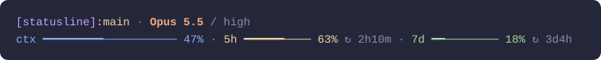

# statusline

A two-line [Claude Code](https://code.claude.com) statusline in the [Catppuccin Macchiato](https://catppuccin.com/palette) palette.



- **Line 1:** folder, git branch, model, and reasoning effort (when thinking is on)
- **Line 2:** context window used, then 5-hour and 7-day plan usage with time until reset (Pro/Max plans)
- Bars turn yellow at 50% and red at 80%. Parts with no data, like plan usage on an API key, are hidden.

## Install

**macOS / Linux** (requires [`jq`](https://jqlang.org/download/): built into macOS 15+, or `brew install jq` / `sudo apt install jq`):

```sh
curl -fsSL https://raw.githubusercontent.com/v0-3/statusline/main/install.sh | bash
```

**Windows** (PowerShell, nothing else needed):

```powershell
irm https://raw.githubusercontent.com/v0-3/statusline/main/install.ps1 | iex
```

The installer copies the statusline script to `~/.claude/` and sets `statusLine` in `~/.claude/settings.json` (the old file is backed up first). Claude Code picks it up automatically. From a clone, run `./install.sh` or `powershell -ExecutionPolicy Bypass -File install.ps1` to install your local copy.

<details>
<summary>Manual install</summary>

Save [`statusline.sh`](statusline.sh) (or [`statusline.ps1`](statusline.ps1) on Windows) to `~/.claude/`. On macOS / Linux, make it executable:

```sh
chmod +x ~/.claude/statusline.sh
```

Then add this to `~/.claude/settings.json`:

```json
{
  "statusLine": { "type": "command", "command": "~/.claude/statusline.sh" }
}
```

On Windows, use `"command": "powershell -NoProfile -ExecutionPolicy Bypass -File C:/Users/you/.claude/statusline.ps1"`.

</details>

## Customize

Colors are defined near the top of [`statusline.sh`](statusline.sh) ([`statusline.ps1`](statusline.ps1) on Windows). Try it with sample input:

```sh
echo '{"workspace":{"current_dir":"/tmp/demo"},"model":{"display_name":"Opus"},"thinking":{"enabled":true},"effort":{"level":"high"},"context_window":{"used_percentage":42},"rate_limits":{"five_hour":{"used_percentage":30},"seven_day":{"used_percentage":12}}}' | ./statusline.sh
```

## Uninstall

Delete the `statusLine` entry from `~/.claude/settings.json` and remove the statusline script from `~/.claude/`.
